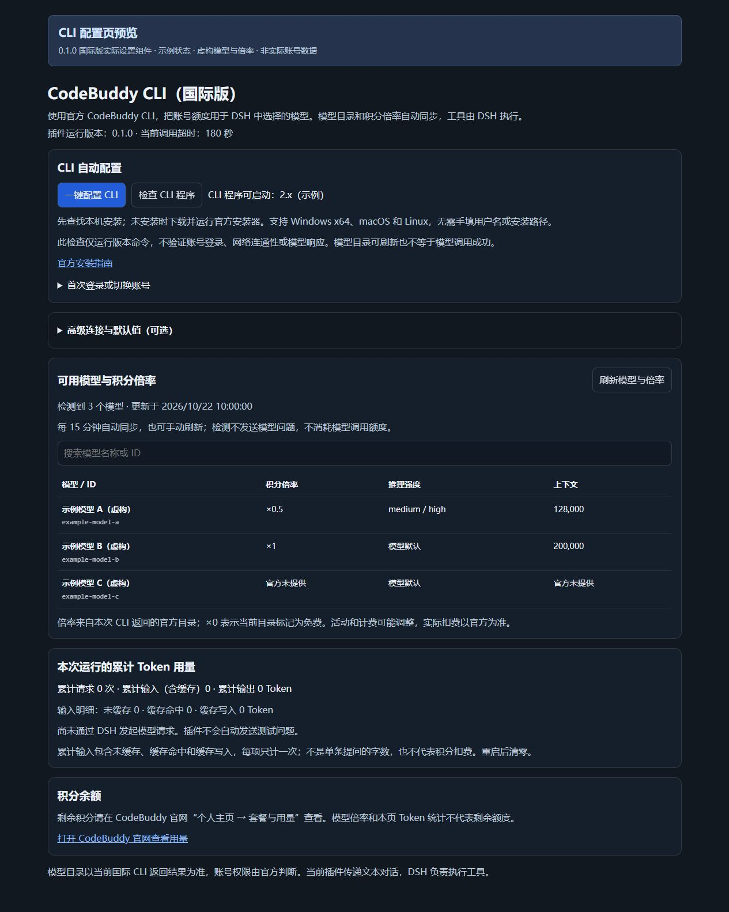
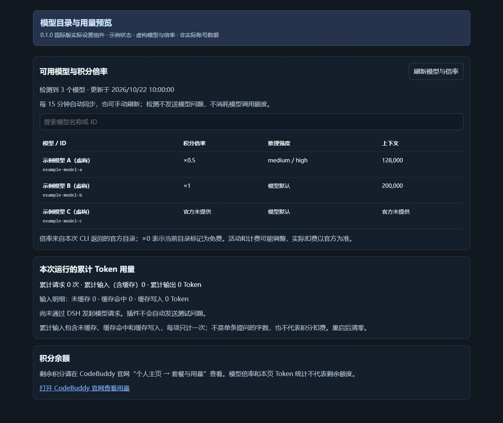
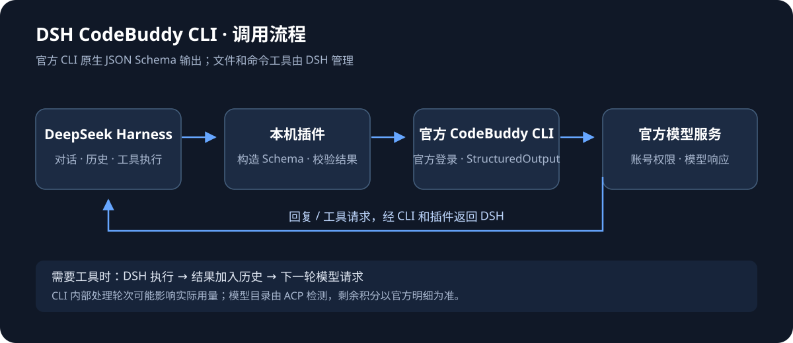

# DSH CodeBuddy CLI（国际版）

**简体中文** · [English](README.en.md)

[下载安装包 0.1.0](releases/dsh-codebuddy-cli-intl-0.1.0.tgz) · [安装教程](docs/安装教程.md) · [工作原理](docs/工作原理.md) · [验证与限制](docs/验证与限制.md) · [更新记录](CHANGELOG.md)

在 DeepSeek Harness（DSH）中，通过本机官方 CodeBuddy CLI 国际站使用账号可用模型。模型提出工具请求，DSH 继续负责执行工具、管理对话与权限。作者不提供中转服务器，也不导入 WorkBuddy 桌面凭据。

## 版本说明

国际版与[国内版](https://github.com/1924225725-collab/dsh-codebuddy-cli-cn)是两个独立插件，版本号独立。此包保留已验证的首版实现，基于国内版 0.2.4；**不包含国内版 0.2.5 的日志与多片段新增改动**。本轮同步已暂停，下一次国际更新预留为 0.3.0，尚未发布。

## 为什么做

原有 WorkBuddy 反代接入方式受到限制后，希望继续保留 DSH 的使用方式，因此改为调用官方 CLI 的无头能力。使用官方 CLI 不等于本插件获得官方授权，不作账号安全或永久可用保证。

## 界面预览

以下由 0.1.0 实际设置组件渲染，模型、倍率和状态均为明确标注的虚构示例，不是账号截图或当前官方模型清单。

当前版本 **0.1.0**，首次国际版发布。基于国内版 0.2.4 的适配实现，通过官方 CodeBuddy CLI 国际站为 DSH 提供模型；工具执行、会话与权限仍由 DSH 管理。

## 安装与登录

1. 在 DSH 插件管理中导入 `dsh-codebuddy-cli-intl-0.1.0.tgz`，启用“CodeBuddy CLI（国际版）”。国内版与国际版的提供方标识不同。
2. 打开国际版插件的配置页，点击“一键配置 CLI”。已有官方 CLI 时直接检测，否则运行官方安装流程。Windows x64、macOS、Linux 有对应检测和安装逻辑；本次真实验证平台为 Windows x64。
3. 复制登录命令，在 PowerShell 或终端运行。进入 CLI 后输入 `/login`，明确选择 **International Site**，在浏览器完成官方登录，返回 CLI 等待认证完成。网页“登录成功”不能代替 CLI 的成功回传。
4. 点击“刷新模型与倍率”。在 DSH 会话中选择 `codebuddy-cli-intl` 下的模型。默认模型可以留空，也可以输入新模型 ID；没有固定模型白名单。
5. 先发一条简短消息，再验证一个小范围工具任务。CLI 版本检测只证明可执行文件可启动。

默认配置目录为当前用户的 `~/.dsh-codebuddy-cli-intl`；可自行指定其他目录。**配置目录隔离不保证官方 CLI 的系统账号存储隔离**，切换账号应使用官方 CLI 流程。插件不读取、解密或导入 WorkBuddy 桌面凭据。

插件明确设置国际环境 `public`。不要为解决国际请求失败而改成国内 `internal`，或删除区域限制后把国内请求成功视为国际接通。官方 SDK 的认证环境 `external` 与 CLI 变量值不同。

## 模型、倍率与用量

模型及倍率来自官方 CLI ACP 目录，每 15 分钟或手动刷新。2026-10-22 测试账号返回了 19 个模型条目（含 Auto/Fast 等路由别名），这不是对所有账号开放相同模型的承诺；未逐一请求全部模型。倍率未返回时显示未知，不猜测数值。

显示 CLI 返回的 Token 统计，不把 Token 换算成已扣积分，也不显示未经官方接口确认的余额。积分与消耗明细请到官方账号中心查看。本次用户确认同一国际 WorkBuddy 账号的用量明细出现了对应测试消耗；这是本账号的验证结果，其他账号和套餐仍以官方账单为准。

## 已验证与限制

- 官方 CLI 2.172.1 国际账号登录成功；一个短请求确实发往 `https://www.codebuddy.ai/v2/chat/completions` 并成功返回。该地址仅为官方 CLI 日志观察结果，插件不会自行请求此地址。
- 使用本插件真实适配器与国际服务完成两轮验证：提出工具请求、接收宿主传入的合成工具结果、输出最终回复。宿主为协议测试环境，没有实际执行系统工具。
- 34 项自动检查通过，包括配置页、模型刷新、倍率、路径检测、结果格式、Token 统计和工具协议。
- 用户已确认国际 WorkBuddy 明细出现对应测试消耗；插件没有抓取或保存账单。尚未完成安装进用户 DSH 后的界面与真实文件工具验收。当前只支持文本输入。
- 这是第三方适配项目；官方 CLI 文档不构成对本插件的官方背书或账号安全保证。

若登录页无法访问，分别排查登录主域名与静态资源的代理路径；不要照抄其他电脑的代理端口、关闭证书校验或直接关闭全部代理。本次电脑的网络修复不自动写入插件。

## 工作流程

完整 JSON 返回后在本地校验，文字或工具请求交给 DSH。关闭 CLI 内置工具、MCP 和会话持久化；不自动追加模型修复请求，不伪造逐 Token 速度。只支持文本输入，剩余积分到官网查看。

## 开发检查

`npm test` 使用模拟 CLI 和合成数据，不需要账号、不发送模型请求。Node.js ≥ 22.19.0，DSH 依赖见 package.json。项目配置与日志凭据不打包。
